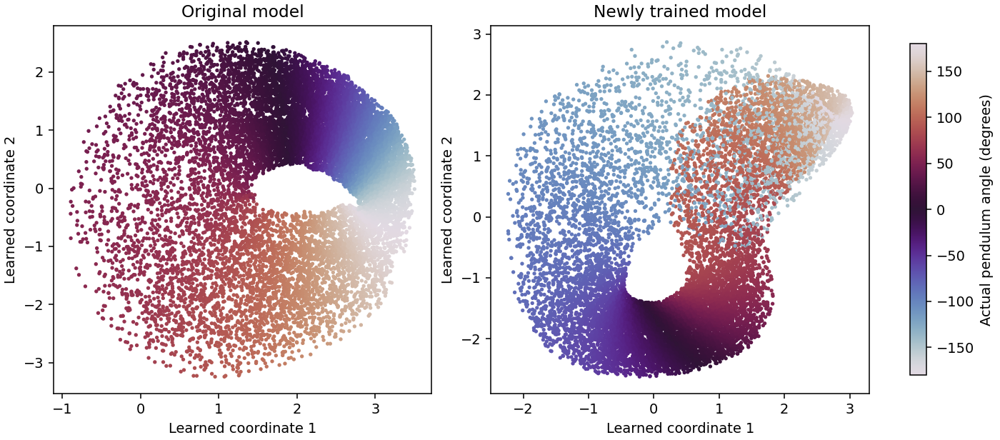
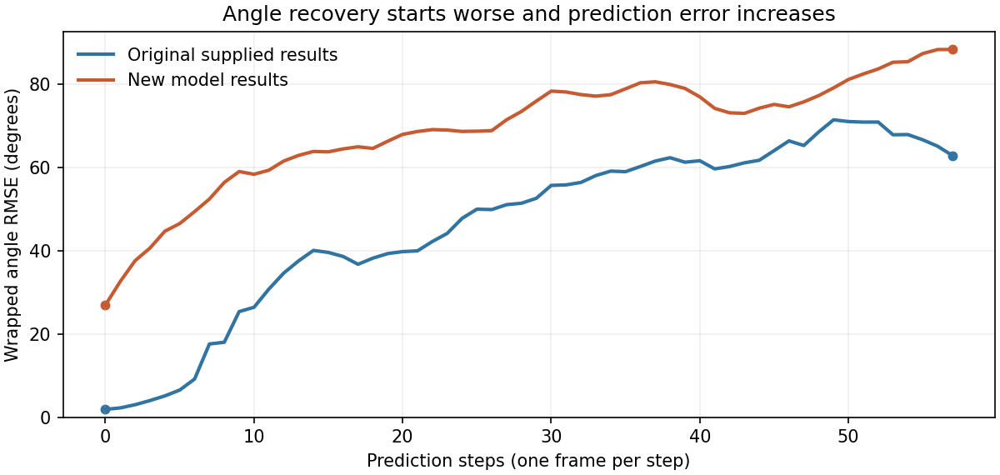

# DySIB Pendulum Model Comparison

Review date: October 18, 2026

The locally retrained model completed 300 epochs and is now connected to the figure-generation pipeline. Its learned representation differs from the supplied model, and angle recovery is substantially worse. The error is already large before future prediction begins. Diagnostic tests point to ambiguity in the learned representation; they do not establish why training reached this solution.

**What changed**

The comparison is between the supplied `checkpoints/kz2_nF2_str1_N1000_rep3.pt` and the new `checkpoints/my_run.pt`. The original model and training implementations are unchanged relative to repository commit `77536c7bced969d32081a64b3d8aa09f8e2cc493`.

| Setting | Supplied model | New model |
|---|---|---|
| Random seed (`rep`) | 3 | 0 |
| Training epochs | 300, recorded in metadata | 300, verified from saved training history |
| Training trajectories | 1,000 | 1,000 |
| Latent coordinates (`kz`) | 2 | 2 |
| Frames per input / future offset | 2 / 1, overlapping windows | Same |
| Frame features / encoder width / predictor width | 32 / 256 / 64 | Same |
| Compression weight / prediction weight | 0.01 / 1.0 | Same |

The analysis configuration changed from the supplied checkpoint to:

```python
CKPT_KZ2 = CKPT_DIR / "my_run.pt"
```

The following command replaced three saved analysis files, after which the figure notebook was rerun:

```bash
python precompute_figure_data.py --only phase_portrait embedding_kz2 rollout_test --force
```

`phase_portrait.npz` now identifies the run as `my_run`. Independently encoding all windows with the new checkpoint reproduced its saved latent coordinates exactly in the diagnostic run. The notebook source cells are unchanged; its saved outputs were regenerated. `understand_dysib.ipynb` is a separate learning aid and does not change model training.

**Which figures changed**

| Figure output | Change and interpretation |
|---|---|
| `Fig_Phase_Space_Traj_Exp_Learned.png` | The learned-state panel changes. The physical angle–velocity and polar panels use unchanged physical data. |
| `Fig_Angle_Omega_Colored_Embeddings.png` | Both panels use new learned coordinates. Angle and velocity labels are unchanged. Different physical states appear more mixed in parts of the new representation. |
| `Fig_Angle_Omega_Energies_Colored_Embeddings.png` | The same coordinate change appears in the angle, velocity, and energy colorings; the physical labels are unchanged. |
| `Fig_Long_Rollout_Test_Set.png` | The learned motion field, paths, reference markers, and error curves are recomputed using the new model. Angle error increases substantially. |

The sweep, training-set-size comparison, eight-dimensional, cylindrical-physics, and prober-ablation data files were **not updated**. Their plots still describe the supplied data and models, even if the notebook regenerated their image files. The new run has not been added to the sweep tables.



Both panels above use the same sampled observations and angle color scale. A rotation or deformation of learned coordinates is not itself an error. The concern is the overlap of substantially different angle colors, particularly in the new model's upper region.

**Measured outcomes**

The table compares the original committed `rollout_test.npz` with the current file. Angle errors are wrapped angular root mean square errors (RMSE) over 200 held-out trajectories. Step 0 measures angle recovery from the observed initial window; step 57 includes 57 learned prediction steps.

| Measurement | Original saved results | New saved results |
|---|---:|---:|
| Initial angle RMSE | 1.92° | 26.94° |
| Angle RMSE after 57 steps | 62.80° | 88.25° |
| Final mean latent Euclidean error | 2.21 | 1.35 |

The lower latent error does **not** establish better physical prediction: each model learns its own coordinate geometry and scale. Although the notebook calls this quantity “Latent Rollout RMSE,” the implementation averages Euclidean distances across trajectories.



Rollout uses 40 stochastic samples per trajectory and a separately fitted angle reader, or *prober*. Those random draws are not fixed in the precompute script, so the displayed rollout values are individual evaluations, not averages across repeated evaluations.

**Diagnostic findings**

Both checkpoints were evaluated on the same local preprocessed data. Frozen encoder means were paired with physical labels at each window's first frame. Training used trajectories 0–999; testing used trajectories 1000–1199, giving 58,000 training windows and 11,600 test windows.

The standard random-feature angle prober was refitted with seeds 0, 1, and 2, keeping its 512 features and ridge penalty of 0.001. These tests measure angle recovery from observed windows, not future rollout.

| Angle RMSE across all windows | Supplied model | New model |
|---|---:|---:|
| Training, range across three prober seeds | 1.84–1.94° | 26.90–26.96° |
| Held-out, range across three prober seeds | 1.59–1.65° | 26.30–26.35° |
| Held-out, alternative five-neighbor angle reader | 0.37° | 26.25° |

The alternative reader averages the sine and cosine labels of the five closest training states. Its poor performance on the new representation supports the finding that the issue is not merely one unlucky prober initialization. Similar training and test errors do not suggest ordinary overfitting as the main explanation.

A nearest-neighbor check found a test observation and a training observation separated by only 0.000324 in the new latent coordinates, despite their physical angles differing by 135.55°. More broadly, 5.49% of test windows had a nearest training neighbor whose angle differed by over 90°, versus none for the supplied model. This supports local ambiguity in the new representation at the sampled resolution; it is not a formal proof that the mapping is non-invertible.

**Interpretation and review priorities**

The higher error is not solely accumulated prediction error: angle recovery is already poor at step 0. DySIB optimizes compression and contrastive future prediction, rather than supervised angle accuracy, so improvement in its training objective need not produce better physical recovery.

Different random initialization and training order are plausible contributors. The supplied sweep contains runs with the same principal settings and angle errors spanning approximately 1.61–40.46°. However, changing the seed has not yet been tested in a controlled retraining comparison. The new checkpoint also omits learning rate and batch size, so checkpoint metadata alone cannot establish complete equivalence with the internal pipeline that produced the supplied model.

Useful next checks for review are:

1. Confirm the intended training and preprocessing settings against the source run, including learning rate and batch size.
2. Retrain with seed 3 and then several additional seeds, keeping other settings fixed and saving separate checkpoints.
3. Compare physical recovery and repeated rollout evaluations, using fixed prober and rollout seeds. If the ambiguity persists, inspect whether the overlapping-window objective is encouraging an insufficient representation of the physical state.

**Supporting evidence**

- [Diagnostic results](diagnostic_results.json): checkpoint settings and all prober and nearest-neighbor measurements.
- [Comparison snapshot](comparison_snapshot.json): original and current error curves, baseline commit, and checkpoint and analysis-file SHA-256 hashes.
- [Diagnostic script](diagnose.py): rerun with `python reports/model_comparison/diagnose.py` from the repository root. It refits diagnostic readers, updates `diagnostic_results.json`, and writes temporary latent arrays; it does not retrain DySIB or replace figure data.

The figures and measurements in this report are a snapshot of the October 18 evaluation. Baseline rollout curves come from the committed supplied results; the controlled prober comparisons re-evaluate both checkpoints on the local dataset.
